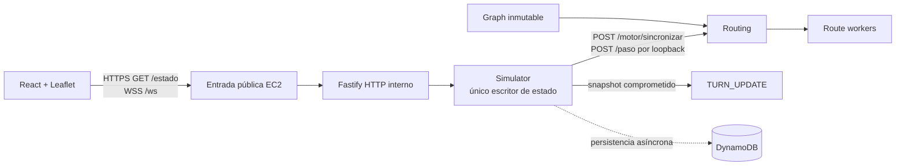

# SpookyThon 2026 — Escape de Manta Zombie

Proyecto Track A con backend de baja latencia, simulación por turnos y mapa en vivo.

## Estado actual

El backend integra el grafo peatonal, routing, simulador, telemetría, publicación HTTP/WebSocket, workers reales de precompute y persistencia asíncrona con recuperación pausada desde DynamoDB. El simulador es el único escritor del estado de la partida. El frontend React/Vite/TypeScript consume `GET /estado` y `WSS /ws` y presenta el mapa, las rondas, las métricas y los controles de operador.

El equipo reportó la configuración desplegada en EC2 el 28 de octubre de 2026. Los cambios locales de esta rama requieren despliegue para ser verificados en AWS; las pruebas locales no acreditan por sí mismas escrituras o aceptación en la cuenta.

| Parámetro | Valor reportado |
|---|---|
| Región AWS (`AWS_REGION`) | `us-east-2` — Ohio |
| Zona de disponibilidad EC2 | `us-east-2a` |
| Tabla DynamoDB | `spookython-manta-state` |
| Base pública HTTPS/WSS | `https://3-128-78-190.sslip.io` |
| Estado público | `https://3-128-78-190.sslip.io/estado` |
| WebSocket | `wss://3-128-78-190.sslip.io/ws` |

DynamoDB es regional: usar `us-east-2` en el cliente AWS; `us-east-2a` identifica la zona de la instancia EC2. Los ejemplos de configuración están en [backend/.env.example](backend/.env.example) e [infra/.env.example](infra/.env.example). La entrada HTTPS/WSS reenvía al backend HTTP interno y debe conservar el upgrade de WebSocket.

## Arquitectura

Un proceso Fastify integra los módulos del backend. El estado de juego vive en RAM y solo el simulador lo muta. Routing construye planes durante la sincronización; los workers calculan esos planes y `/paso` consulta las tablas locales en O(1). La cola persiste snapshots comprometidos fuera del ciclo de turno. El frontend es una aplicación independiente que recibe snapshots por HTTP y WebSocket.



## Documentación

- [SPEC.md](SPEC.md): fuente técnica canónica.
- [Checklist de lanzamiento](docs/launch-checklist.md): prioridades, aceptación y evidencias pendientes.
- [Costos AWS](docs/costos.md): tarifas, fórmulas y evidencia disponible.
- [Arquitectura Draw.io](docs/arquitectura.drawio) y [operación/rollback](docs/operacion-rollback.md).
- [OpenAPI 3.1](backend/openapi/openapi.yaml) y [configuración de infraestructura](infra/README.md).
- [Refugios provisionales](docs/refugios-provisionales.md) y [complemento «Ojos de Águila»](docs/complemento-ojos-de-aguila.md), que documenta el catálogo simulado y sus limitaciones.
- [Módulos Backend](backend/src/modules/README.md) y guías de [Michael](docs/team/michael/README.md), [Maykel](docs/team/maykel/README.md) y [Kristhian](docs/team/kristhian/README.md).
- [Extracción del grafo](scripts/README.md).

## Backend local

Requiere Node.js 24.12+ de la serie 24.

```bash
npm --prefix backend ci
npm --prefix backend test
npm --prefix backend run typecheck
ROUTE_API_KEY='use-a-secret-of-at-least-16-characters' npm run backend:start
npm run benchmark:routing
```

`/health/ready` comprueba que el grafo, routing, workers y persistencia estén listos; no exige una partida activa. Antes de iniciar una partida, `GET /estado` responde `503 GAME_NOT_STARTED`.

## Frontend local

```bash
cd frontend
npm ci
npm run dev
npm test
npm run typecheck
npm run lint
npm run build
```

El frontend carga el grafo desde `frontend/public/data/grafo_manta.json`. Para conectar el backend, configura la URL en `.env` siguiendo `.env.example`. Los controles deben usar el mecanismo de operador/proxy configurado; no se debe incluir una API key privilegiada en el bundle del navegador.
