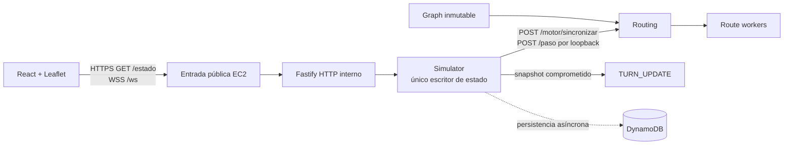

# SpookyThon 2026 — Escape de Manta Zombie

Proyecto Track A con backend de baja latencia, simulación por turnos y mapa en vivo.

## Estado

El backend incluye grafo peatonal, motor Base de rutas, simulador, telemetría, publicación HTTP/WebSocket, persistencia DynamoDB asíncrona, recuperación pausada y workers de precompute. La release `a09f235` se desplegó y verificó en EC2 con persistencia real y tres rondas de 150 turnos. Sus máximos p95 fueron 26,4 / 50,1 / 89,3 ms y la disponibilidad fue del 100 %; R2 registró un cierre tardío y un deadline miss, por lo que el criterio de cero incumplimientos sigue pendiente. La evidencia está en [integracion-2026-10-28](docs/evidence/integracion-2026-10-28/README.md). Los cambios posteriores incluidos en esta rama, entre ellos las detecciones simuladas de Ojos de Águila, aún requieren despliegue para validarse en AWS.

| Área | Estado |
|---|---|
| Grafo de Manta | Publicado y validado: 300 nodos, 736 aristas, un SCC, cuatro refugios alcanzables desde todo nodo. Mismo `graphVersion`/SHA-256 en `backend/data/` y `frontend/public/data/`. |
| Motor de rutas (graph/routing) | Implementado: Dijkstra inverso por `worldVersion`, `bestMoveByNode` O(1), `x-api-key`, fallback al nodo actual. |
| Simulador (game loop) | Integrado de punta a punta: `city-events → zombie-move → sync → routing → survivor-move → resolve → publish`, 150 turnos serializados, pausa/reanudación, cierres de segmento. |
| Realtime | `GET /estado` y `WSS /ws` publican el mismo snapshot tras cada commit. |
| Ojos de Águila | Rebanada simulada implementada: detecciones temporales de zombies activos modifican rutas y se muestran en el mapa. Ubicaciones y coberturas son aproximadas; sin video ni conexión real. No desplegada. |
| Rondas reales (R1/R2/R3) y telemetría | Integradas desde `feat/backend-rounds-metrics`; las pruebas de backend se ejecutan en esta rama combinada. |
| Persistencia (DynamoDB) | Adaptador, cola asíncrona y recuperación pausada implementados. La release `a09f235` fue verificada con persistencia real en EC2; consultar la evidencia para distinguir esa versión de los cambios posteriores de esta rama. |
| Frontend | Scaffold completo Vite + React + TypeScript + Tailwind + Leaflet: mapa en vivo, métricas, ocupación de refugios, controles de operador, leyenda colapsable, reconexión WS con backoff. 11/11 tests. |
| AWS | El equipo reporta EC2 en Ohio, DynamoDB y CloudWatch/SNS operativos. La release backend `a09f235` tiene evidencia de despliegue; los cambios posteriores de `design`, incluido Ojos de Águila, no se han desplegado. La integración final reporta p95 máximos de 26,4 / 50,1 / 89,3 ms; R2 registró un deadline miss, por lo que el criterio conjunto de cero misses no se cumple. [Evidencia de integración](docs/evidence/integracion-2026-10-28/README.md) y [CloudWatch](docs/evidence/cloudwatch-2026-10-28/README.md). |

## Despliegue confirmado en EC2

Configuración comunicada por el equipo el 28 de octubre de 2026. La SCP de la organización permite operar en Ohio.

| Parámetro | Valor reportado |
|---|---|
| Región AWS (`AWS_REGION`) | `us-east-2` — Ohio |
| Zona de disponibilidad EC2 | `us-east-2a` |
| Tabla DynamoDB | `spookython-manta-state` |
| Base pública HTTPS/WSS | `https://3-128-78-190.sslip.io` |
| Estado público | `https://3-128-78-190.sslip.io/estado` |
| WebSocket | `wss://3-128-78-190.sslip.io/ws` |

DynamoDB es regional: usar `us-east-2` en el cliente AWS; `us-east-2a` identifica la zona de la instancia EC2. Los ejemplos de configuración están en [backend/.env.example](backend/.env.example) e [infra/.env.example](infra/.env.example). La entrada HTTPS/WSS debe reenviar al backend HTTP interno y conservar el upgrade de WebSocket.

## Arquitectura

Un proceso Fastify integra los módulos del backend. El estado de juego vive en RAM y solo el simulador lo muta. Routing instala planes durante la sincronización; los workers realizan el precompute y `/paso` consulta las tablas locales en O(1). La cola persiste snapshots comprometidos fuera del ciclo de turno. El frontend recibe snapshots por HTTP y WebSocket.



## Documentación

- [SPEC.md](SPEC.md): fuente técnica canónica.
- [Checklist de lanzamiento](docs/launch-checklist.md): prioridades, aceptación y evidencias pendientes.
- [Costos AWS](docs/costos.md): tarifas, fórmulas y evidencia disponible.
- [Arquitectura Draw.io](docs/arquitectura.drawio) y [operación/rollback](docs/operacion-rollback.md).
- [OpenAPI 3.1](backend/openapi/openapi.yaml) y [configuración de infraestructura](infra/README.md).
- [Refugios provisionales](docs/refugios-provisionales.md) y [complemento «Ojos de Águila»](docs/complemento-ojos-de-aguila.md), que documenta el catálogo simulado y sus limitaciones.
- [Módulos Backend](backend/src/modules/README.md) y guías de [Michael](docs/team/michael/README.md), [Maykel](docs/team/maykel/README.md) y [Kristhian](docs/team/kristhian/README.md).
- [Extracción del grafo](scripts/README.md).

## Ejecutar en local

Requiere Node.js 24.12+ de la serie 24.

### Backend

```bash
npm --prefix backend ci
npm --prefix backend test
npm --prefix backend run typecheck
ROUTE_API_KEY='use-a-secret-of-at-least-16-characters' npm run backend:start
npm run benchmark:routing
```

`/health/ready` comprueba que el grafo, routing, workers y persistencia estén listos; no exige una partida activa. Antes de iniciar una partida, `GET /estado` responde `503 GAME_NOT_STARTED`.

### Frontend

```bash
cd frontend
npm ci
cp .env.example .env
npm run dev
npm test
npm run typecheck
npm run lint
npm run build
```

El frontend carga el grafo estático desde `frontend/public/data/grafo_manta.json` y puede mostrar mapa, leyenda y refugios sin backend. Para conectarlo, configura la URL en `.env` siguiendo `.env.example`. No se debe incluir una API key privilegiada en el bundle del navegador.
